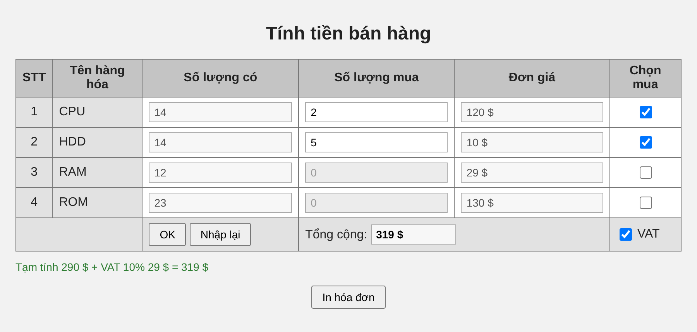
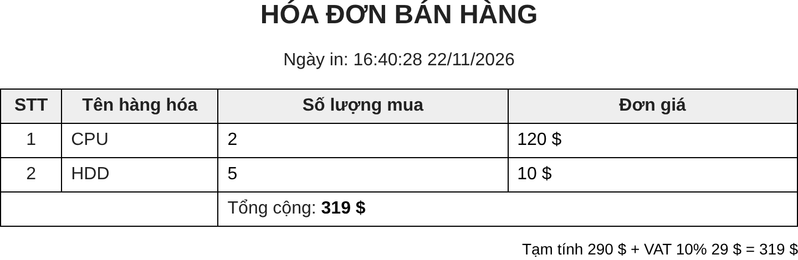

# Bài 3.4 – Ứng dụng Tính tiền bán hàng

Bài tập JavaScript trong sách *Bài tập Thiết kế Web*, mục **3.4. Ứng dụng Tính tiền bán hàng** (Hình 3.5).

## Kết quả



Bản in khi bấm **In hóa đơn**:



## Yêu cầu

- **a)** Đánh dấu **Chọn mua** thì ô **Số lượng mua** của dòng đó được mở để nhập. Kiểm tra số lượng mua có hợp lệ không.
- **b)** Nhấn **OK** thì ô **Tổng cộng** hiện tổng tiền các sản phẩm được chọn. Nếu đánh dấu **VAT** thì cộng thêm 10%.
- **c)** Nút **Nhập lại** đưa mọi ô về giá trị ban đầu để tính lần mới.
- **d)** In bằng hàm `window.print()`, kết hợp CSS để định dạng nội dung in.

## Cấu trúc

```
js-tinh-tien-ban-hang/
├── index.html          # bảng hàng hóa CPU, HDD, RAM, ROM
├── style.css           # giao diện màn hình + @media print cho bản in
├── script.js
├── screenshot.png      # ảnh màn hình
└── screenshot-in.png   # ảnh bản in
```

## Kiến thức JavaScript sử dụng

- `querySelectorAll` lấy các dòng của bảng, vòng lặp `for` xử lý từng dòng
- Sự kiện `change` của checkbox; mở hoặc khóa ô nhập bằng thuộc tính `disabled`
- Kiểm tra số lượng mua bằng biểu thức chính quy `/^\d+$/`: phải là số nguyên từ 1 đến số lượng có; ô sai được tô đỏ ngay khi gõ
- `parseInt`, `parseFloat` để đổi chuỗi sang số; tính tổng tiền và cộng VAT 10%
- `window.print()` để in; CSS `@media print` ẩn các nút, cột "Chọn mua", cột "Số lượng có", các hàng không mua và thêm tiêu đề "HÓA ĐƠN BÁN HÀNG"

## Cách chạy

Tải repo về (**Code → Download ZIP**) rồi mở file `index.html` bằng trình duyệt.
